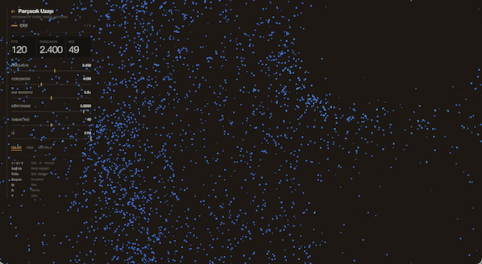

# Parçacık Uzayı

HTML5 Canvas (2D) üzerinde çalışan, harici kütüphane bağımlılığı bulunmayan interaktif bir fizik ve parçacık simülasyonu.

Fare imleci bir çekim merkezi görevi görür; parçacıklar imlece doğru çekilir veya itilir. Hıza bağlı dinamik renklendirme, sürtünme fiziği ve şok dalgası mekaniklerini içerir.



## Hızlı Başlangıç

Proje, çalışma zamanında Node.js (v20+) haricinde herhangi bir paket kurulumu veya derleme adımı gerektirmez.

Yerelde çalıştırmak için depoyu klonladıktan sonra doğrudan şu komutu çalıştırın:

```bash
npm start

```

Uygulama varsayılan olarak `http://localhost:5173` adresinde çalışır. İlgili port meşgulse otomatik olarak bir sonraki boş porta geçer.

## Kontroller ve Etkileşim

| Girdi | İşlev |
| --- | --- |
| **Sol Tık (Basılı Tutma)** | Şok dalgası / İtme kuvveti |
| **Sağ Tık** | Etkileşim modu geçişi |
| **`1` / `2` / `3`** | Çekme / İtme / Kaos modları |
| **`Boşluk` (Space)** | Simülasyonu duraklat / Devam ettir |
| **`M` / `R` / `T`** | Sesi Aç-Kapat / Sıfırla / İzleri Aç-Kapat |

*Arayüz :* Ekranın sol üst köşesindeki kontrol panelinden parçacık sayısı, kütleçekim kuvveti, sürtünme katsayısı ve iz solma hızı gibi parametreler gerçek zamanlı olarak ayarlanabilmektedir.

## Mimari ve Optimizasyon

Proje, yüksek parçacık sayılarında (3000+) performanslı çalışabilmesi için şu tekniklerle optimize edilmiştir:

* **Fixed Timestep:** Fizik hesaplamaları ekran yenileme hızından bağımsız olarak 120 Hz sabit zaman adımıyla (dt) işlenir; böylece kare hızı dalgalansa bile simülasyon kararlılığı bozulmaz.
* **Spatial Hashing:** Parçacık etkileşimleri ve ekran sınırı hesaplamaları, maliyetli O(n^2) taramalar yerine tekdüze uzamsal ızgara kullanılarak optimize edilmiştir.
* **Batch Rendering:** Parçacıklar Canvas üzerine tek tek çizilmek yerine hızlarına göre renk gruplarına ayrılıp toplu olarak çizilir. Bu sayede her karedeki `fill()` ve context çağrıları en aza indirilmiştir.

## Dizin Yapısı

```text
src/
├── config.js       # Simülasyon parametreleri ve global sabitler
├── physics.js      # Kuvvet, ivme ve sürtünme vektör hesaplamaları
├── grid.js         # Spatial hash ızgara algoritması
├── particles.js    # Parçacık veri havuzu ve state güncellemeleri
├── colors.js       # Hız bazlı renk haritalama
├── renderer.js     # Canvas 2D çizim motoru
├── interaction.js  # Fare etkileşimleri ve girdi yönetimi
├── audio.js        # Web Audio API tabanlı ses efektleri
└── main.js         # Ana döngü ve UI bağlayıcı

```

## Testler

Çekirdek fizik motoru ve hesaplama modülleri DOM mimarisinden izole edilmiştir. Bu sayede unit testler tarayıcıya ihtiyaç duymadan doğrudan Node ortamında koşabilir:

```bash
npm test

```

## Lisans

Bu proje açık kaynak lisansına sahip değildir. Tüm hakları saklıdır (`UNLICENSED`). Kopyalanmasına veya izinsiz kullanılmasına izin verilmemektedir.
